<p align="center"></p>

# Township

Society management for Company A's 2,400-flat, 28-tower township in Pune: residents pay maintenance, raise
complaints, approve visitors and book the clubhouse from one installable web app; bank statements match themselves;
guards log visitors on a tablet that keeps working offline; and the committee gets a monthly report it can trust.

**Live:** https://township-91vm.onrender.com/welcome (Render free plan: the first visit after a quiet spell takes about a
minute). Demo sign-ins are listed on the sign-in page; codes appear on screen because SMS is mocked.
**Docs:** [Technical design](docs/Township-TDD.pdf) · [Deployment and demo logins](deployment.md) · [Evaluation](docs/evaluation.md)

## Screens

| Sign in | Home | Bills | Complaints | Visitors | Book | Dark mode |
|---|---|---|---|---|---|---|
| 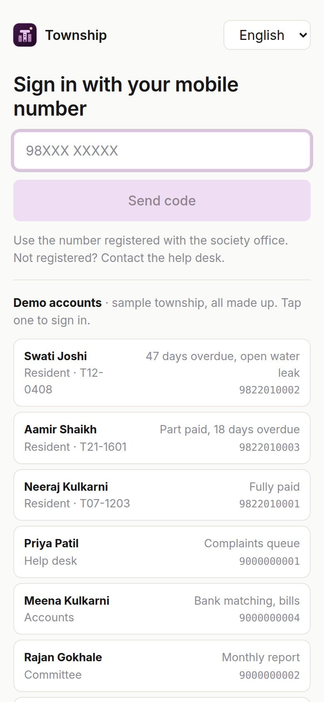 | 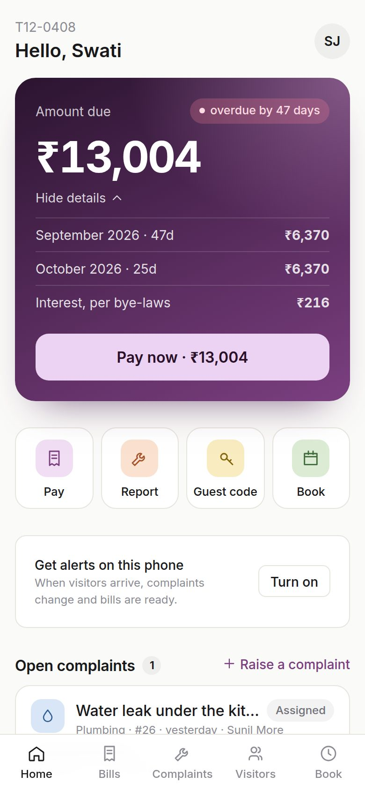 | 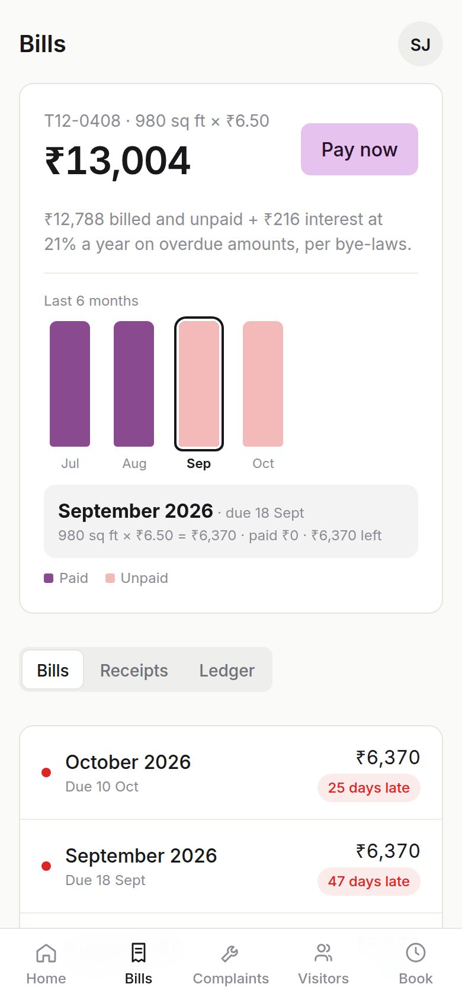 | 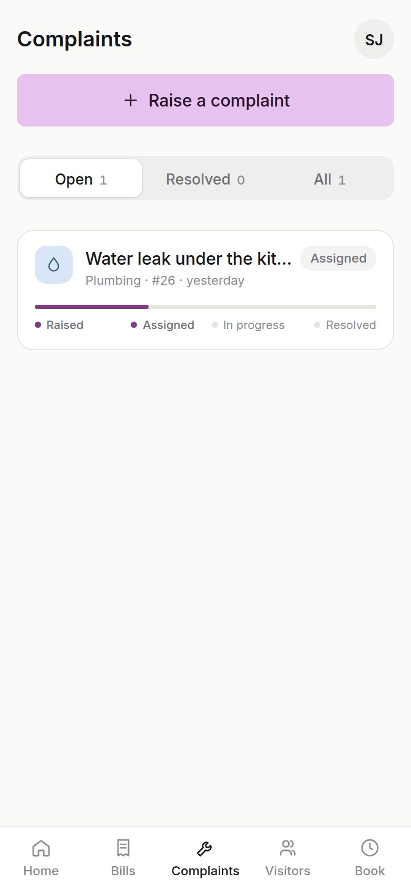 | 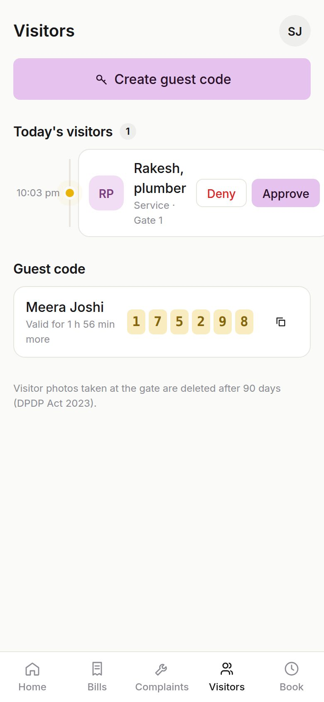 | 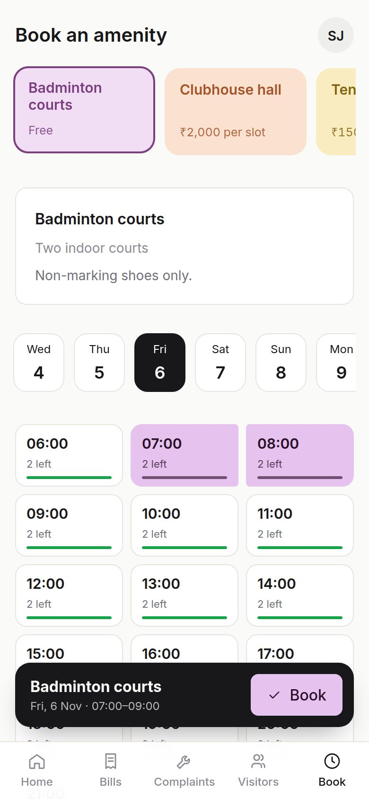 | 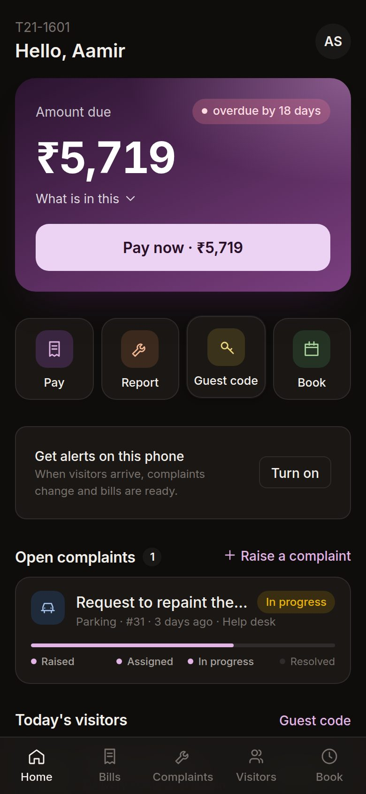 |

| Help desk queue | Bank matching |
|---|---|
| 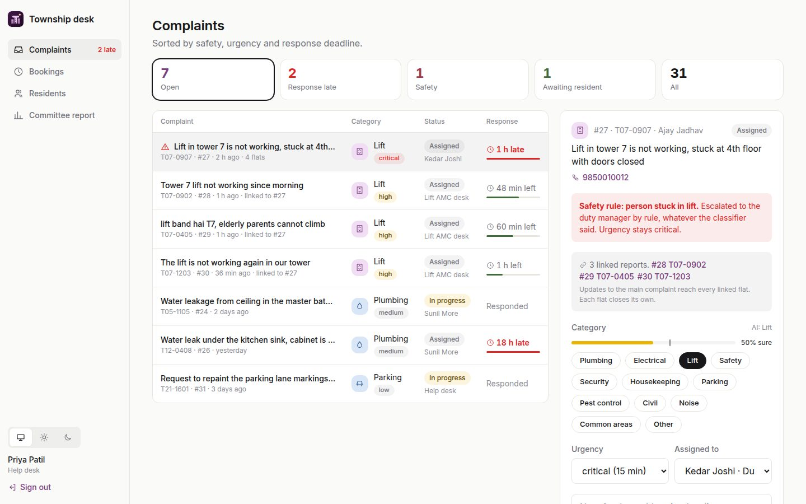 | 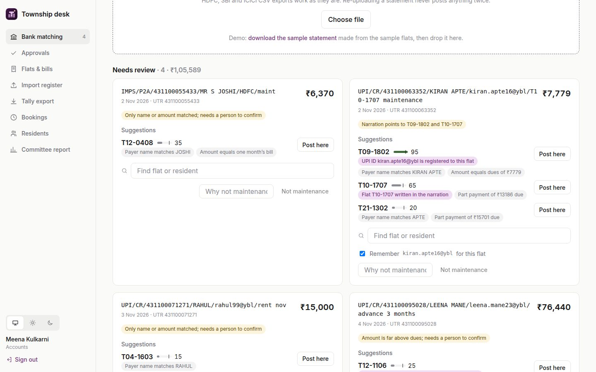 |
| **Committee report** | **Gate tablet, offline** |
| 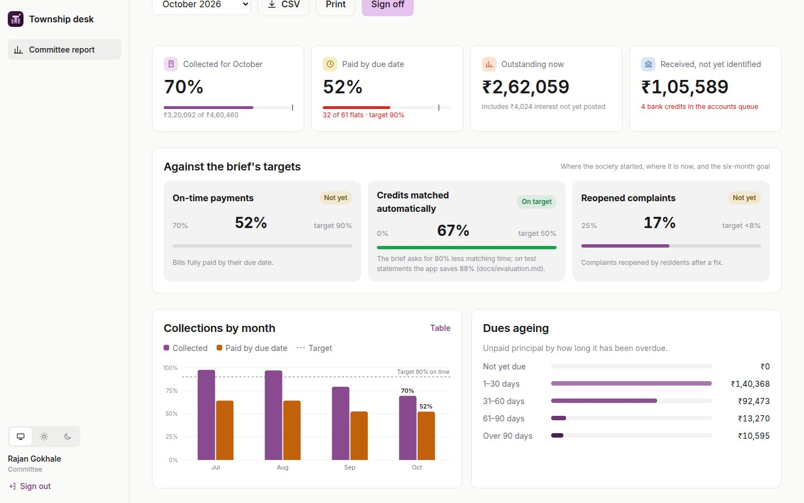 | 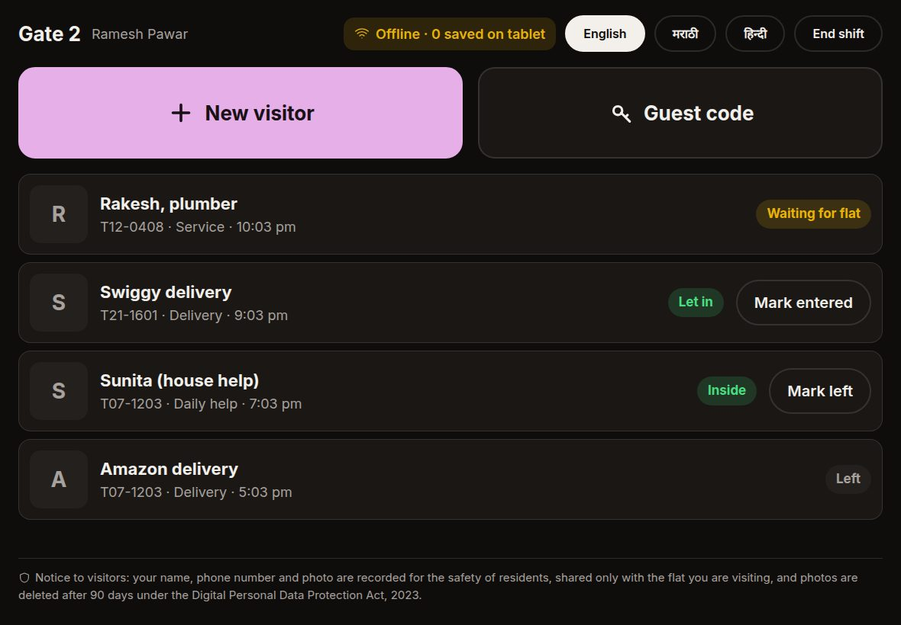 |

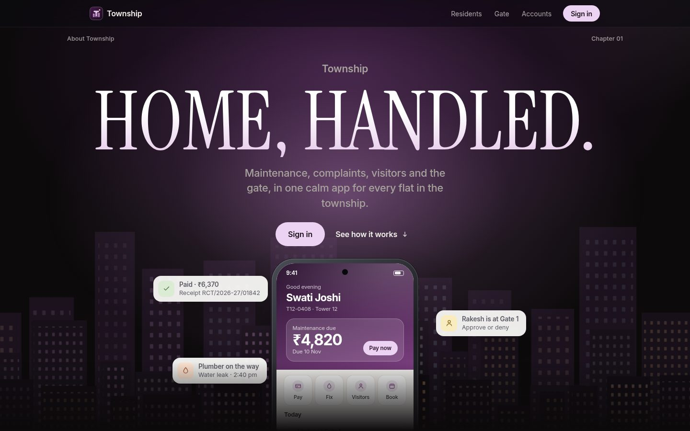

## What it does

| Who | Features |
|---|---|
| **Residents** (phone) | An installable web app on every screen size (an **Install app** button in the front page, desk and resident navigation: the browser's prompt on Chrome and Edge, desktop and Android; the steps for Safari on iPhone, iPad and Mac; home-screen shortcuts; an offline app shell); sign in with a one-time code; home with dues, open complaints and today's visitors, every action within two taps; bills as area × rate with late interest per bye-laws, a six-month chart, test-mode payment, numbered receipts with PDFs and a ledger; complaints with photo, AI category and urgency, a live status timeline, rating or reopening; approve or deny visitors and send guest codes; book amenities by slot with fees on the bill; family and tenant members; notices; push alerts; English, Marathi and Hindi; light and dark |
| **Help desk** | A queue sorted by safety, urgency and response deadline; auto-assignment to technicians by category and tower; one-tap category change with the AI's confidence shown; linked duplicates; status updates and notes; resident details with audited corrections |
| **Accounts** | Bank CSV import that posts confident credits and queues the rest with reasons and suggestions; two-person approval of manual posts and adjustments; flats and ledgers; monthly bill runs; register import from Excel; Tally export |
| **Committee** | Monthly report from the ledger: collections, dues ageing, complaint times and the brief's targets; approves bill runs; signs off a month, which freezes it with a fingerprint |
| **Guards** (tablet) | Visitor entry with photo, resident approval, guest codes, very large buttons on a dark screen, an offline queue, PIN sign-in on a paired tablet, the DPDP notice on screen |
| **Admin** | Settings (rate, due day, interest, bank), staff, technicians, gate tablets, amenities, notices, message outbox, data requests, audit log |

**AI and automation, measured** (`npm run eval`, [full report](docs/evaluation.md)): on 90 labelled complaints the local
classifier gets 81% of categories right and is right every time it says it is sure; all 14 hazards escalate with no
false alarms. On five realistic month-end statements (140 credits), **no credit is posted to the wrong flat**, 55% post
themselves, and matching takes about 88% less time than by hand (the brief's target is 80%).

**Tested:** 53 server tests and 6 browser tests, plus a full-size load test (2,400 flats, 95% of requests under 28 ms at
five times the bill-day peak).

## Runs free

Nothing paid is needed. Each paid service has a free placeholder that is used automatically when its
credentials are missing, and each placeholder is clearly labelled where people see it:

| Paid service | Free placeholder |
|---|---|
| SMS login codes (MSG91) | The code is shown on the sign-in screen, for registered numbers only |
| Online payment (Razorpay) | A test gateway: same order and recording steps, a marked test checkout, receipts say "test payment, no money moved" |
| Photo storage (S3) | The server's own disk (a Docker volume) |
| Hosting (AWS) | Render's free plan (`render.yaml`), or `docker compose up --build` on any machine |
| Complaint AI (Claude) | The built-in keyword classifier |

Push alerts are free already (`npm run cli -- vapid-keys`). Adding real credentials later switches each service on
with no code change.

### Quickest start: everything in Docker

```bash
docker compose up --build       # or docker-compose up --build; app on http://localhost:4000
```

The sample township (the brief's three flats plus about 60 more, with residents, bills, complaints, visitors and
bookings) loads on first start, because `DEMO_DATA=true` in `docker-compose.yml`. It only loads into an empty database.

## Run locally (development)

Needs Node 20+ and Docker.

```bash
docker compose up -d db                                            # PostgreSQL 16 on localhost:5440
docker compose exec db psql -U township -c "create database township_test"
npm install
npm run dev:fixtures          # sample township
npm run dev                   # API :4000 (migrates on start), app http://localhost:5173
```

Without SMS configured, the login code is shown on the sign-in screen. `npm test` runs the suite against
`township_test`; `npm run eval` scores the AI and the matching; `npm run test:e2e` runs the browser tests.

## Design

Warm and minimal, after OpenDesign's "Neutral Modern" structure, with a palette after grail-app.com:

- **Palette:** warm off-white and zinc ink, one lilac accent (dark text on it) for the next action, plum for accent
  text; a warm near-black dark mode. Six soft tints (lilac, peach, butter, sage, sky, rose) only tell categories,
  people and amenities apart; green, amber and red are kept for status.
- **Interaction:** the dues card opens into what makes up the amount, a tapped month in Bills shows its sum, a waiting
  visitor pulses, guest codes count down, picked booking slots join into one block. CSS only, and off under reduced motion.
- **Themes:** light and dark, chosen under Profile → Appearance (residents) or at the bottom of the desk sidebar (staff).
- **Gate tablet:** always dark, for night shifts and glare.
- **Charts:** colours checked for colour-blind safety and contrast in both themes.
- **Logo:** a T made from a tower between two shorter ones, with a sun.
- **Front page** (`/welcome`): a scroll-driven page built with GSAP, loaded on its own so the app carries none of it.

## Configuration

All settings come from environment variables; `.env.example` lists them. Production needs only `DATABASE_URL`
and `FILE_URL_SECRET`. Every paid service is optional, and the server logs which placeholders it is running with.

| What | Variables | Notes |
|---|---|---|
| Database | `DATABASE_URL` (or `PGHOST`, `PGUSER`, `PGPASSWORD`, `PGDATABASE`), `DATABASE_SSL` | PostgreSQL 14+. With `DATABASE_SSL=true` the server's certificate is verified (Amazon RDS's bundle is included). Migrations run on start unless `MIGRATE_ON_START=false`. |
| SMS login codes | `SMS_PROVIDER=msg91`, `MSG91_AUTH_KEY`, `MSG91_OTP_TEMPLATE_ID` | DLT-approved template containing `##otp##` |
| Safety alerts by SMS | `MSG91_ALERT_TEMPLATE_ID` | Optional; template with `##message##` |
| Payments | `RAZORPAY_KEY_ID`, `RAZORPAY_KEY_SECRET`, `RAZORPAY_WEBHOOK_SECRET` | Test keys work end to end |
| Photos | `STORAGE=s3`, `S3_BUCKET`, `AWS_REGION`, `FILE_URL_SECRET` | Optional; without S3, photos are stored under `STORAGE_DIR` on the server |
| Push alerts | `VAPID_PUBLIC_KEY`, `VAPID_PRIVATE_KEY`, `VAPID_SUBJECT` | Free. Generate with `npm run cli -- vapid-keys` |
| Complaint AI | `ANTHROPIC_API_KEY` | Optional; a local keyword model is used without it |
| Behind a load balancer | `TRUST_PROXY=true` | So rate limits see real client addresses |

Set the Razorpay webhook to `https://<domain>/api/payments/razorpay/webhook` for the events
`payment.captured` and `order.paid`.

## Going live

1. Deploy. Free: Render with `render.yaml`, or `docker compose up --build`. For a paid production setup on AWS Mumbai,
   [infra/aws/README.md](infra/aws/README.md) has the Terraform and the step-by-step.
2. Create the first administrator:
   `npm run cli -- create-admin --name "Full Name" --phone 98XXXXXXXX`
3. Sign in as that admin and set up the society. Under **Admin**:
   - **Settings:** rate per sq ft, bill and due days, the interest rate from your bye-laws, and the bank account.
   - **Staff:** help desk, accounts, committee and guard accounts, with a PIN for each guard.
   - **Technicians:** who handles each complaint category, and which towers they cover.
   - **Gate tablets:** register each tablet, then open `/gate` on it and enter its pairing code.
4. Import flats, residents and opening balances under **Import register**. Start from the template, or upload your
   own Excel or CSV sheet; columns are found by their headings. The preview shows every change and any problem,
   and nothing is saved until you press Import. Opening balances can be loaded once per flat.
   Interest is charged only on bills raised in the app; opening arrears carry no interest here.
5. Accounts prepares the month's bills under **Flats & bills**. A committee member approves them on the
   **Committee report** page, and only then are bills issued and residents notified.

Also set the **Tally ledger names** under Admin → Settings, add **amenities** under Admin → Amenities, and
print the **gate notice** from Admin → Settings for each gate.

`npm run test:e2e` builds the app and runs browser tests of the main flows in headless Chrome (set `CHROME_PATH`
if Chrome is elsewhere). Set `SENTRY_DSN` to report server and browser errors to Sentry; no personal data is sent.

## How it works

### Roles
| Role | Can do |
|---|---|
| Resident (owner, tenant, family) | Own flat only: pay, complain, approve visitors, guest codes, add family |
| Help desk | Complaints; correcting residents' details |
| Accounts | Bank matching, approvals, flats and ledgers, bill runs, adjustments |
| Committee | Report; approves bill runs; signs off monthly reports |
| Admin | Everything above, plus staff, tablets, technicians, settings, notices, audit log |
| Guard | Gate console, only on a paired tablet, signed in with a PIN |

### Security
- **Login codes:** random 6-digit codes, stored only as hashes, valid for 5 minutes, with 5 tries per code.
- **Rate limits:** at most 3 codes per number per hour, and limits per network address.
- **Unregistered numbers:** get the same reply as registered ones, so the endpoint can't be used to find out who lives here.
- **Sessions:** last 30 days for residents and 12 hours for staff and guards. Only a hash of each token is stored, and deactivating a person ends their sessions.
- **Gate tablets:** paired once with a single-use code and revocable from Admin.
- **Headers:** strict security headers and a Content Security Policy. Fonts are bundled with the app, so there are no third-party requests except Razorpay.
- **Database role:** in production the app connects as its own role (`npm run cli -- grant-app-role`). That role cannot
  change tables or switch off the append-only triggers, and cannot update or delete ledger, payment, audit or
  signed-report rows at all. So even a compromised app cannot rewrite the books. Migrations run separately, as the owner.
- **Login numbers:** a resident's mobile number is their login. A change made by the help desk takes effect only
  after accounts or the admin approves it.
- **Push alerts:** only the browsers' own push services (Google, Mozilla, Apple, Microsoft) are accepted as alert
  addresses. Any other address is refused, so the server can't be pointed at internal systems.
- **Spreadsheet exports:** text that Excel would run as a formula is neutralised in every CSV, so a UPI note like
  `=HYPERLINK(…)` can't execute on the treasurer's computer.
- **Integrity check:** `npm run cli -- verify` confirms:
  - every payment and bill has exactly one ledger line,
  - receipt numbers have no gaps,
  - the append-only triggers are on,
  - signed reports match their fingerprints.

  Run it after any restore.

### Money
- **Ledger:** every rupee is a ledger line. The ledger, payments and audit log are **append-only, enforced
  by the database**; corrections are adjustments, never edits.
- **Interest:** simple interest on overdue principal at the rate set under Settings (21% a year at most).
  Payments settle interest first, then the oldest bills.
- **Online payments (Razorpay):**
  - Orders are created on the server.
  - The checkout signature is verified.
  - The payment is fetched from Razorpay, so the amount never comes from the browser.
  - A signed webhook also records the payment, in case the resident closes the app mid-payment.
  - The payment is recorded exactly once.
- **Bank statements:** a credit posts automatically only when there is strong evidence (the flat number in the
  narration, or a registered UPI ID) and the match is clear. Everything else goes to a queue.
  - Statements uploaded twice post nothing new.
  - Razorpay settlements are recognised and are not posted to a flat.
  - Debits are ignored.
- **Two-person check:** posting a queued credit, dismissing one, ledger adjustments, and changing a resident's login
  number all wait for a second person to approve. The database rejects anyone approving their own request.
- **Receipts:** numbered gaplessly per financial year, `RCT/2026-27/00001`.
- **Bill runs:** accounts prepares a month's bills once the bill date has arrived. A committee member who
  didn't prepare them approves, and the bills are issued at the rate in the draft, even if the setting changed
  in between. Residents get an alert.
- **Signed reports:** the committee signs a month's report. The figures are frozen in a table that can't be
  edited, with a SHA-256 fingerprint the app re-checks every time the signed copy is shown. CSV downloads of a
  signed month come from the frozen copy.

### Amenity booking
- **Setup:** admin sets each amenity's hours, slot length and places per slot, fee per slot, limits per booking
  and per flat per week, how far ahead people can book, the free-cancellation cut-off, and the rules.
- **Fees:** charged to the flat's maintenance account, and credited back on a cancellation made before the
  cut-off. A refund always cancels its own charge, not an older bill.
- **No overbooking:** two flats can't take the last place at the same moment.
- **Closed days:** closing an amenity for a day cancels and refunds that day's bookings, and the flats are told.

### Receipts and Tally
- **PDF receipts:** A5 receipts with the amount in words, in Indian numbering (lakh and crore). They show the
  balance as it stood right after that payment, so a receipt downloaded again never changes.
- **Tally export:** a Tally XML import file for a date range.
  - Bills, interest, amenity charges and adjustments are Journal vouchers; payments are Receipt vouchers.
  - Each flat gets its own ledger, created under Sundry Debtors, or all flats share one ledger.
  - Every voucher balances.
  - Exporting dates that were already exported needs confirmation, because Tally would duplicate the vouchers.
  - A day book CSV is also available.

### Complaints
- **Classification:** category and urgency come from Claude when configured, otherwise a local keyword model.
- **Safety words:** fire, gas, lift stuck and shock (English, Hindi, Marathi) escalate to the duty manager by
  rule, with an SMS alert. Their urgency can't be lowered.
- **Duplicates:** reports of the same tower asset are linked. They follow the main complaint's status, but each
  flat closes its own.
- **Response targets:** set per urgency.
- **Closing:** residents rate the fix or reopen it.

### Messages
Every SMS, push and WhatsApp message goes through an outbox table in the same transaction as the action that
caused it, and a worker delivers it. Admin → Messages shows each message's status.

- **Urgent first:** a visitor waiting at the gate and safety alerts go before bulk messages. One bill run queues
  about 4,200 bill alerts; a visitor alert queued right after them was handled in under a second in the load test.
- **No lost messages:** the worker claims a batch, sends it outside any transaction (ten at a time), and keeps going
  until the queue is empty. A batch left behind by a crashed worker is retried after five minutes. Several app
  servers can share the queue.

- **Push alerts:** go to residents who turn on alerts on their phone (from the home screen or their profile).
  They cover visitors at the gate, complaint updates and new bills. Tapping an alert opens the right screen.
- **Skipped messages:** a message to someone who hasn't turned alerts on, or for a channel without a provider,
  is recorded as `skipped`, never as sent.
- **WhatsApp:** not built yet.

### Personal data (DPDP Act 2023)
- **Consent:** residents see a privacy notice and give consent at first sign-in.
- **Download:** residents can download all the data held about them as a file, from their profile.
- **Correction:** residents can ask for a correction. The help desk corrects details under **Residents**, and
  each change is audited with the old and new values.
- **Erasure:** residents can ask for their data to be deleted, which admin handles under **Admin → Data
  requests**. Erasure closes the account, ends sessions and alerts, and deletes complaint photos and notes.
  Bills, payments and receipts are kept, because the society must keep its accounts by law.
- **Photos:** stored in S3, encrypted at rest. They are served only through 15-minute signed links, issued to
  people allowed to see them. Uploads are checked to be real JPEG, PNG or WebP images.
- **Visitor photos:** deleted automatically after the configured number of days (90 by default).
- **Gate notice:** the gate screen shows the notice to visitors.
- **Access logging:** staff actions are written to the audit log.

## Load test

`npm run load:seed` builds a full-size township in a separate local database (`township_load`):
- 2,400 flats in 28 towers, with about 4,200 residents
- a year of bills and payments
- 6,000 complaints
- 393,000 gate entries
- 150,000 messages

`npm run load:run` then:
- **Starts the API.**
- **Drives realistic traffic:** 85% residents, 10% gate tablets, 5% desk.
- **At fixed arrival rates:** sized from a bill-day peak of about 8 requests a second.
- **With users clicking without pause:** to find one server's ceiling.
- **Times the heavy jobs:** report, bill run, bank statement, Tally export and register preview.

It writes `tmp/load-report.json` and fails if a target is missed. Reseed before rerunning, since the jobs change data.

Latest results, from one app process on a laptop with the database on the same machine, all targets met:

| | Before this round | Now | Target |
|---|---|---|---|
| 40 requests a second (5× bill-day peak) | — | 95% under 28 ms, no errors | 95% under 300 ms |
| Ceiling of one process | about 100 req/s | about 270–300 req/s, no errors | — |
| Committee report (five people at once) | 5.0 s (25 s) | 1.7 s (1.1 s) | 5 s |
| Bill run, 2,400 flats | 43 s | 4.1 s | 30 s |
| Visitor alert behind 4,200 bill alerts | not sent after 60 s | 0.9 s | 10 s |
| Bank statement, 2,400 credits | 108 s | 17.5 s | 30 s |
| Tally export, one month (7 MB) | 0.4 s | 0.4 s | — |

## Layout

```
server/
  index.js        start: config check, migrations, housekeeping, outbox worker
  app.js          HTTP app, security headers, Razorpay webhook
  env.js          configuration and production checks
  db.js           PostgreSQL pool, transactions, migrations
  migrations/     schema, versioned
  routes/         auth, resident, desk, gate, admin
  lib/            billing, matcher, csv, razorpay, sms, notify, auth, approvals,
                  complaints, classifier, report, settings, audit
  cli.js          migrate, create-admin, vapid-keys, grant-app-role, verify
  demo/           the sample township, loaded on first start in demo mode
  eval/           labelled complaints and statements; npm run eval
  test/           node:test suites (never shipped)
web/src/          React app: resident, desk, gate; landing/ is the front page
docs/             technical design (PDF and source), evaluation, screenshots
e2e/              browser tests of the main flows
load/             full-size seed and load test
infra/aws/        Terraform for AWS Mumbai, deploy and restore-drill scripts
.github/          CI: tests, image, Terraform checks, deploy
Dockerfile        production image
```
